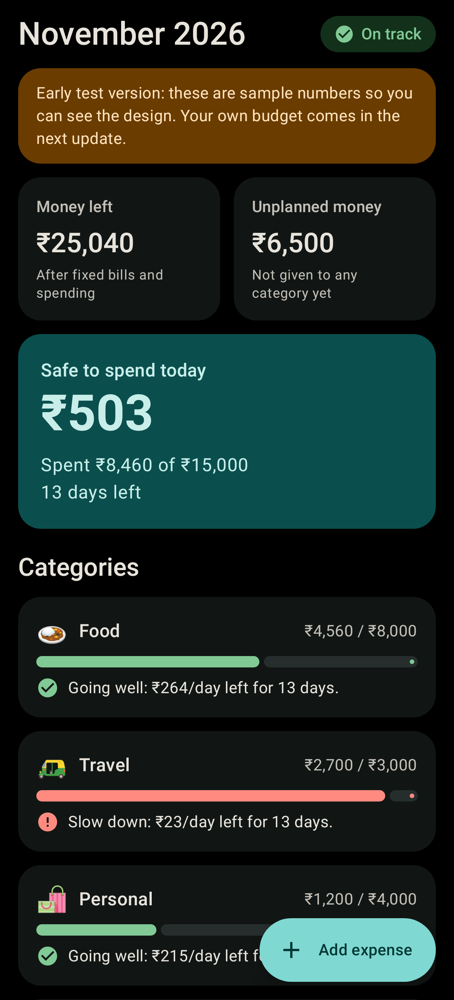
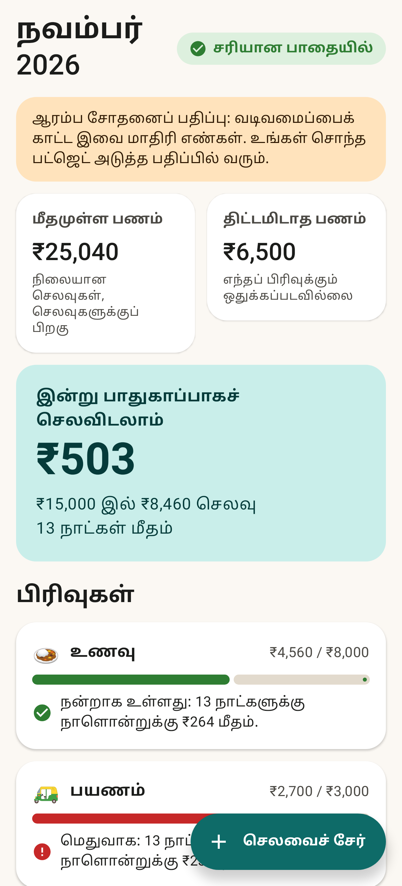

# MySelavu

**MySelavu** ("selavu" = expense in Tamil) is a personal monthly salary, budget and expense
tracker for one person in India. Amounts are in rupees with Indian digit grouping (₹1,23,456).

- **Fully offline.** The app has no internet permission. No accounts, no ads, no tracking.
  Everything stays on your phone.
- **Free.** Built in the cloud by GitHub Actions. You only install the APK.

> **Status: Phase 1 of 6 (early test version).** The calculation engine and database are ready.
> The app currently shows a design preview with sample numbers. Your own budget arrives in Phase 2.

## Screenshots

| Light | Dark | Tamil |
|---|---|---|
|  |  |  |

All screenshots: [docs/screenshots](docs/screenshots/README.md) (updated automatically on every build).

## How to install the test app on your phone

1. On your phone, open **https://github.com/abbastatistician2026-a11y/MySelavu/releases**
2. Find the newest **"Test build #…"** at the top.
3. Under **Assets**, tap **`MySelavu-TEST-build-….apk`** to download it.
4. Open the downloaded file. If Android asks, allow **"Install unknown apps"** for your browser.
5. The app appears as **MySelavu TEST** with an orange **TEST** badge.

The TEST app installs **next to** the real app and keeps **separate data**, so you can try
things safely. Each new test build installs over the previous one; your test data stays.

## How the money works (plain English)

- **Money left** = salary + extra income − fixed expenses − what you've spent.
- **Unplanned money** = salary + extra income − fixed expenses − what you've given to categories.
- **Safe to spend today** = what's left in your spending categories ÷ days left in the month.
- **Colours** always come with an icon and a sentence:
  - ✅ Green "On track": spending is in line with the month.
  - ⚠️ Amber "Careful": a little faster than usual.
  - ⛔ Red "Overspending": at this pace you will go more than 10% over, or the money is almost gone with days still left.
- **End of the month** (you choose in Settings): unspent money is **Moved to savings** (default),
  **carried forward** to the same category, or **reset**. Money in a *Savings* category always goes to your Savings pot.
- **Budget month start day:** if your salary comes on the 28th, set the start day to 28 and
  every month runs from the 28th to the 27th.
- **Changing salary or a bill** asks "from this month or from next month?". Past months never change.

## For the curious: how it's built

- `core/`: pure Kotlin "engine": money in paise (never decimals), budget months, month-end
  rollover, warnings, pattern learning, recurring due dates, goals, lent/borrowed. Fully unit-tested.
- `app/`: the Android app (Jetpack Compose, Material 3, Room database).
- `.github/workflows/build.yml`: the cloud build (tests → screenshots → APK → Releases page).

See [CHANGELOG.md](CHANGELOG.md) for what changed in each phase.
