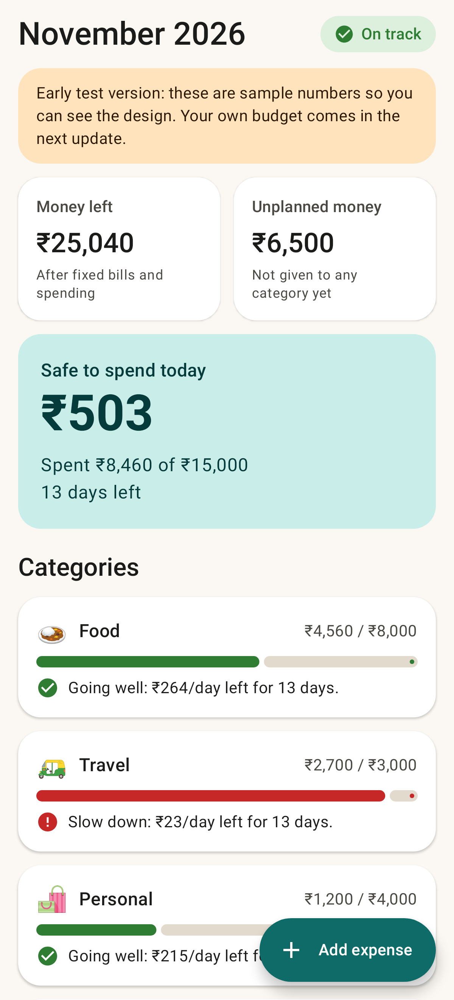
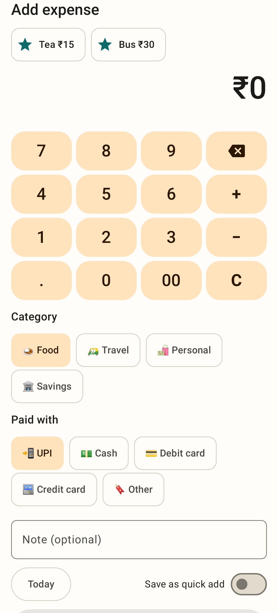
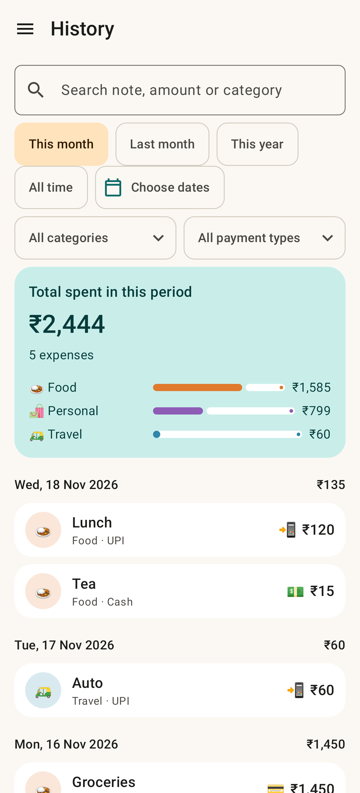
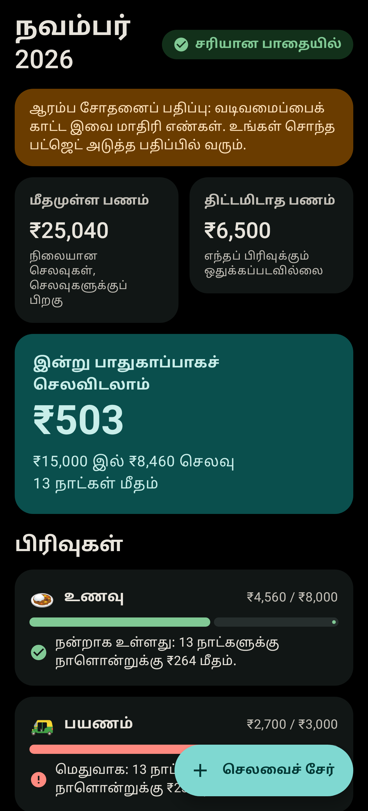

# MySelavu

**MySelavu** ("selavu" = expense in Tamil) is a personal monthly salary, budget and expense tracker
for one person in India. Amounts are in rupees with Indian digit grouping (₹1,23,456).

- **Fully offline.** No internet permission, no accounts, no ads, no tracking. Your data stays on your phone.
- **Small.** The app is under 2 MB. Your data is about 160 bytes per expense: 10 years of daily use is around 6 MB.
- **Safe.** Save a password-locked backup to Google Drive (or anywhere) whenever you like, and restore it on any phone.
- **Free.** Built in the cloud by GitHub Actions. English and Tamil.

## Screenshots

| Home | Add expense | History | Tamil (dark) |
|---|---|---|---|
|  |  |  |  |

All screenshots: [docs/screenshots](docs/screenshots/README.md) (updated automatically on every build).

## Installing

**The real app:** open https://github.com/abbastatistician2026-a11y/MySelavu/releases on your phone,
find the newest **MySelavu v…** release (not a "Test build"), and tap **`MySelavu-v….apk`**.
If Android asks, allow "Install unknown apps" for your browser. New versions install over the old one
and keep your data.

**The TEST app** ("Test build #…" on the same page) installs *next to* the real app with its own separate data
and an orange TEST badge. Use it to try new things safely; it also has Developer tools (demo data, time travel).

## User guide

**First start.** Choose your language, enter your salary, your fixed monthly bills (rent, family fund…) and how
much you want to give each category (food, travel…). Every step can be skipped. Already used MySelavu on another
phone? Tap **Restore my backup** on the first screen.

**Home screen.**
- **Money left** = salary + extra income − fixed bills − what you've spent.
- **Unplanned money** = salary + extra income − fixed bills − what you've given to categories.
- **Safe to spend today** = what's left in your spending categories ÷ days left.
- Each category shows spent / planned with a colour **and** an icon and sentence:
  ✅ green "On track", ⚠️ amber "Careful", ⛔ red "Overspending". After two finished months the warnings learn
  how you usually spend (for example, groceries bought early in the month).
- Tick fixed bills as **paid**, use **Quick add** buttons for things you buy often, and tap the eye to hide amounts.

**Adding an expense.** Tap **+ Add expense**, type the amount (sums like `120+45` work), the most likely category
is already chosen, tap **Save**. Tap any expense later to change it, delete it, or add it again today.
Swipe left in History to delete. Every delete has **Undo**.

**Changing things.** Salary, fixed bills and category amounts can be changed any time from the menu ☰.
You're asked **"From this month or from next month?"**. Past months never change.

**Menu ☰**
| Item | What it does |
|---|---|
| History | Every expense by day with daily totals. Search, filter by category or payment type, and pick any date range to see its total. |
| Month-wise summary | Each month: income, fixed bills, spent, left over, moved to savings; tap for categories. |
| Year-wise summary | Each year's totals, spending by month and by category. |
| Salary & income | Change salary, salary history, add bonuses or gifts (extra income). |
| Fixed expenses | Add, change or remove monthly bills. |
| Categories | Add, change, reorder or remove categories; move money between them for this month. |
| Suggested plan | Suggested amounts per category based on what you really spent in past months. |
| Export to Excel | One .xlsx file with all your data (or one month, or a date range). |
| Backup & storage | Space used, backup and restore, clear old history. |
| Profile & settings | Name, language, theme, month start day, what happens to leftover money. |

**End of the month.** In Settings choose what happens to unspent money: **Move to savings** (default, it goes to
your Savings pot), **Carry forward** (each category keeps its leftover), or **Start fresh**. If your salary comes
on the 28th, set the month start day to 28. If you don't open the app for a while, missed months are filled in correctly.

## Your data: size, backups and clearing history

- **Size:** about 160 bytes per expense, so even 10 expenses a day for 10 years is roughly 6 MB.
  *Menu → Backup & storage* shows the exact space used.
- **Backup (recommended monthly):** *Menu → Backup & storage*, type a password, tap **Save backup file**, and choose
  **Google Drive** (or any folder) in the screen that opens. The file is compressed and locked with AES-256 encryption;
  without your password nobody can open it. **If you forget the password, that backup can't be restored**, so write it down.
  The home screen reminds you once a month.
- **Restore:** *Menu → Backup & storage → Restore from backup file* (or on the first setup screen of a new phone).
  You'll see what's in the file and must confirm before it replaces your current data.
- **Clear history:** delete history older than 1, 2 or 5 years, or all past months. This month, your salary/bills/categories
  and your Savings pot total are kept. You can also choose to **keep history for 3, 5 or 10 years** automatically
  (default: forever), or **delete all data and start again**.
- Android's own Auto Backup (if enabled on your phone) also includes the app's database in your Google account backup.

## Making a new release (for the owner)

The release signing key and its passwords live only in GitHub Secrets (`KEYSTORE_BASE64`, `KEYSTORE_PASSWORD`,
`KEY_ALIAS`, `KEY_PASSWORD`), never in this repository. To publish a version:

1. Open https://github.com/abbastatistician2026-a11y/MySelavu/actions/workflows/build.yml
2. Click **Run workflow**. Choose the branch (normally `main`), type the version (e.g. `1.0.1`) and click the green **Run workflow** button.
3. After about 10 minutes the new **MySelavu v1.0.1** appears on the Releases page with the `.apk` (for your phone)
   and the `.aab` (for the Play Store).

## Publishing on the Google Play Store (optional)

The app can be free on Play, but Google charges a **one-time US$25** developer registration fee.

1. **Create a developer account** at https://play.google.com/console (personal account, pay US$25 once, verify your
   identity with a government ID; this can take a few days).
2. **Create the app** in Play Console: name "MySelavu", default language, *App*, *Free*.
3. **Closed test first (required for new personal accounts):** Google currently requires new personal developer accounts to run a
   closed test with **at least 12 testers for 14 days** before production. Add friends' Gmail addresses as testers,
   upload the `.aab` there, and ask them to install it and keep it installed for 14 days.
4. **Fill in the app content forms:**
   - *Privacy policy URL*: use https://github.com/abbastatistician2026-a11y/MySelavu/blob/main/docs/PRIVACY.md
   - *Data safety*: "No data collected", "No data shared".
   - *Ads*: no ads. *Content rating* questionnaire: a finance/utility app, all answers "No".
   - *Target audience*: 18+. *Financial features*: it's a personal budgeting tool; no loans, payments or banking.
5. **Store listing:** short and full description, the app icon (512×512 PNG), a feature graphic (1024×500) and at least
   2 phone screenshots (you can use the ones in `docs/screenshots`).
6. **Upload** `MySelavu-v….-play-store.aab` from the Releases page. Accept **Play App Signing** (Google keeps a copy
   of the signing key; your own key becomes the "upload key").
7. After the closed test, apply for **Production**, then send for review (usually a few days).

Note: if you install from Play, it's the same package name as the APK from GitHub, so uninstall the GitHub version first
(make a backup!) or keep using the GitHub APK only. Play also requires the app to target a recent Android version each year,
so expect a small update once a year.

## For the curious: how it's built

- `core/`: pure Kotlin "engine": money in paise (never decimals), budget months, month-end rollover,
  warnings, pattern learning, plan suggestion, Excel writer, backup encryption. Fully unit-tested.
- `app/`: the Android app (Jetpack Compose, Material 3, Room database).
- `.github/workflows/build.yml`: the cloud build (tests → screenshots → APK → Releases page; signed release on demand).

See [CHANGELOG.md](CHANGELOG.md) for what changed in each version.
