# MySelavu screenshots

Generated automatically by the cloud build (build #13). Light and dark mode, English and Tamil.

### 01_home_en_light

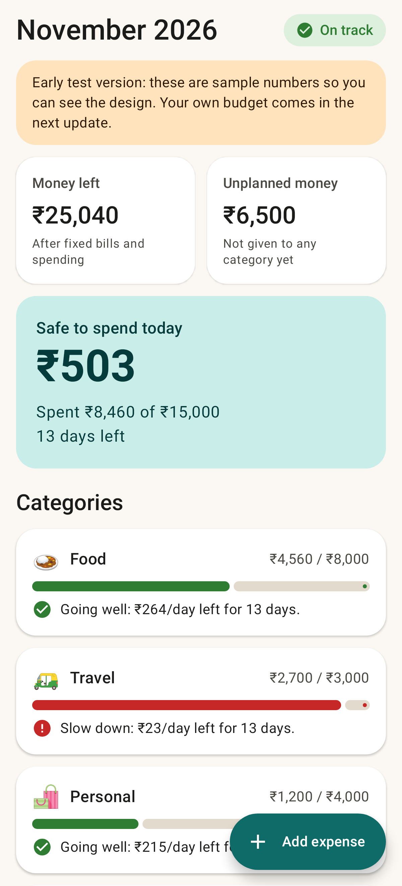

### 02_home_en_dark

### 03_home_ta_light

### 04_home_ta_dark

### 05_home_en_hidden_amounts

### 06_home_en_large_font

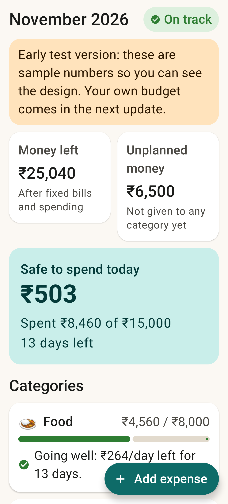

### 07_launcher_icons

### 08_add_expense_en_light

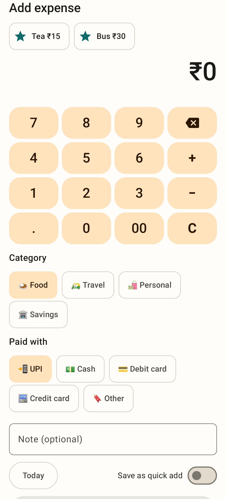

### 09_add_expense_ta_dark

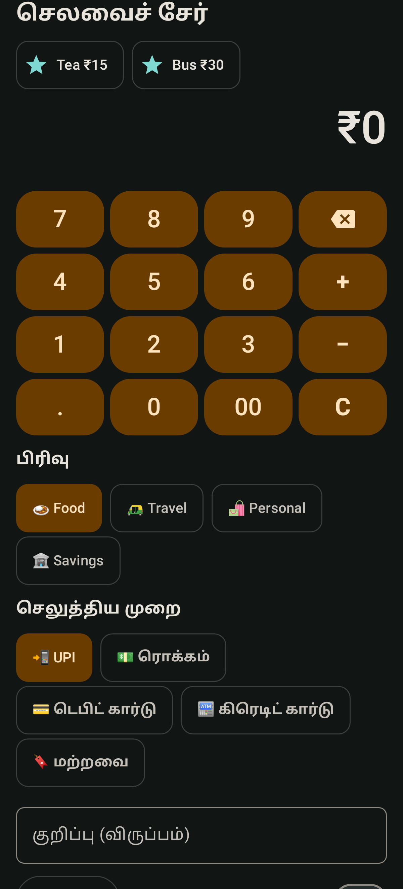

### 10_history_en_light

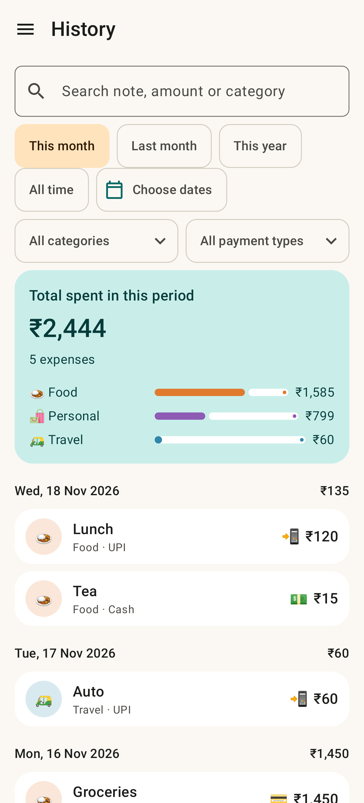

### 11_history_ta_dark

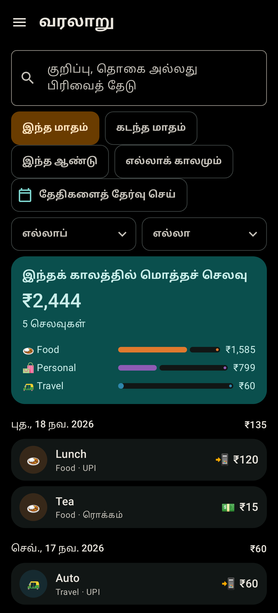

### 12_month_summary_en_light

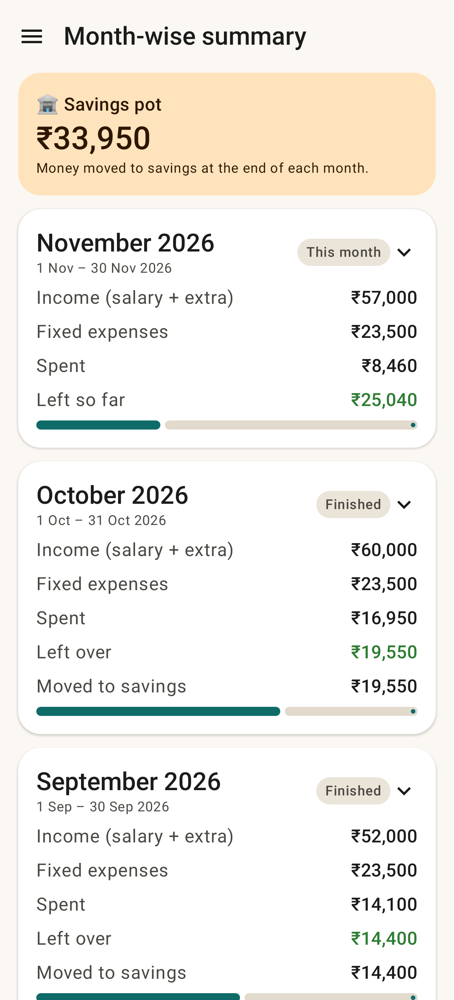

### 13_year_summary_en_dark

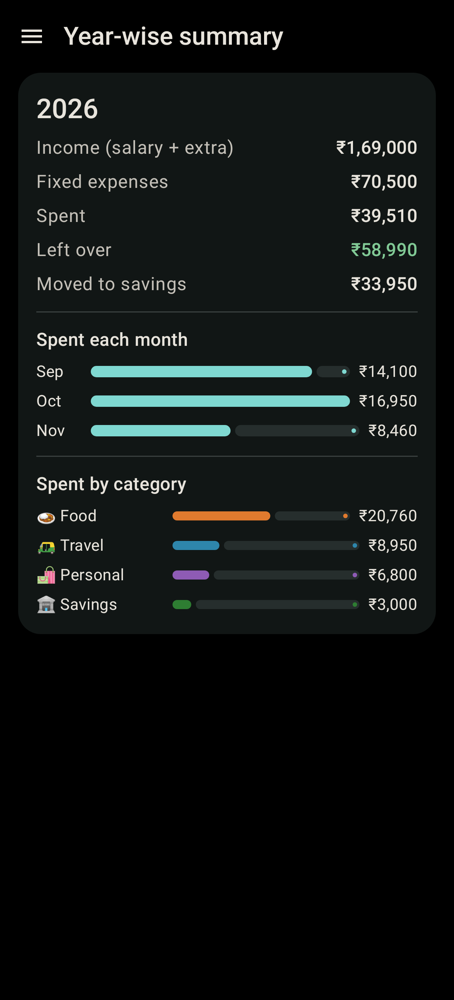

### 14_categories_en_light

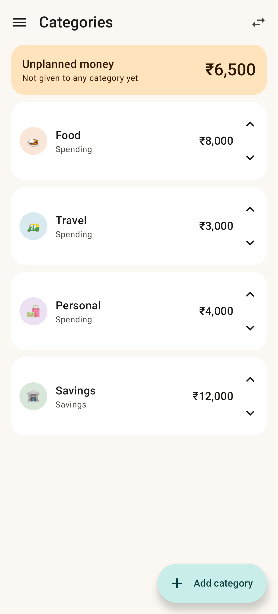

### 15_salary_en_light

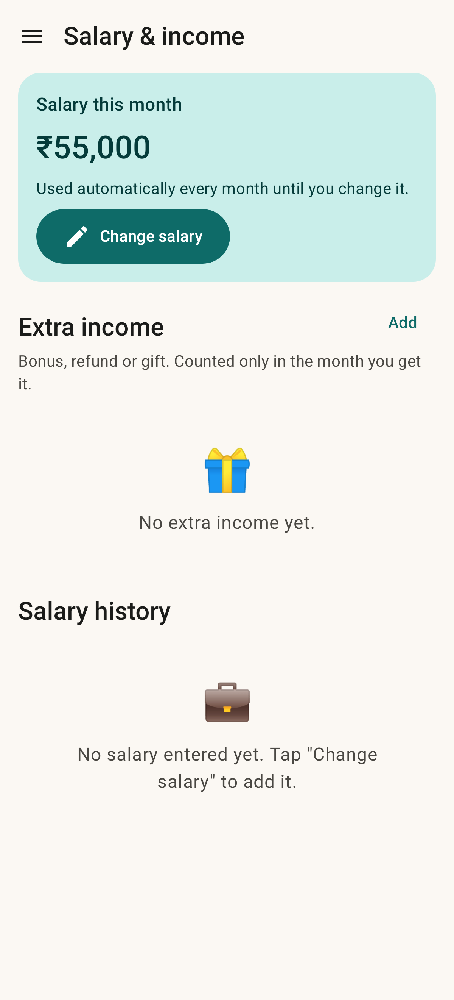

### 16_settings_en_light

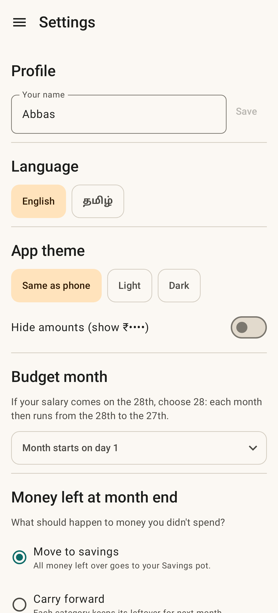

### 17_setup_welcome_en_light

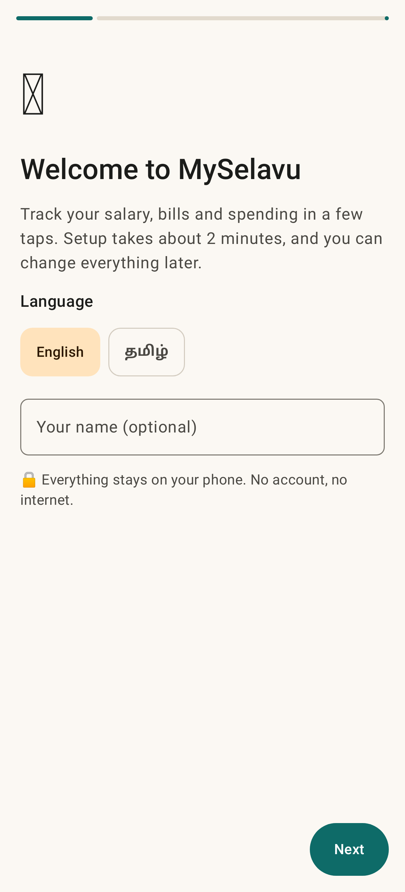

### 18_setup_welcome_ta_light

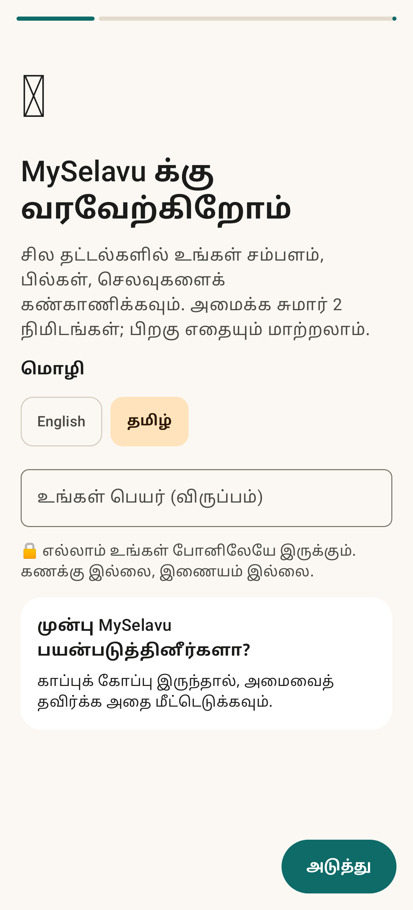

