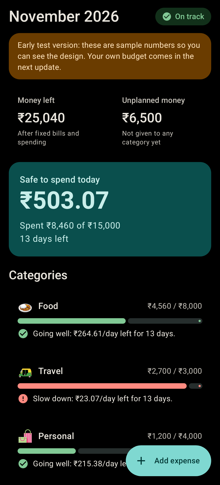
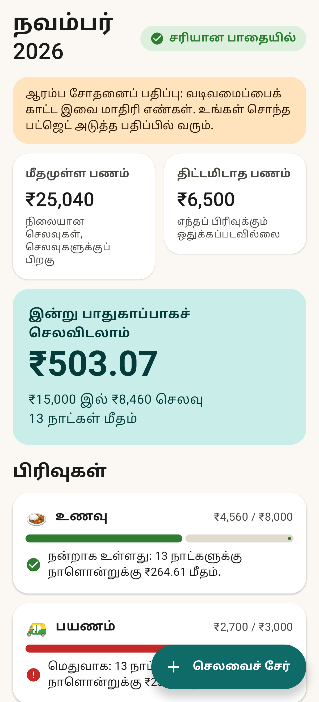
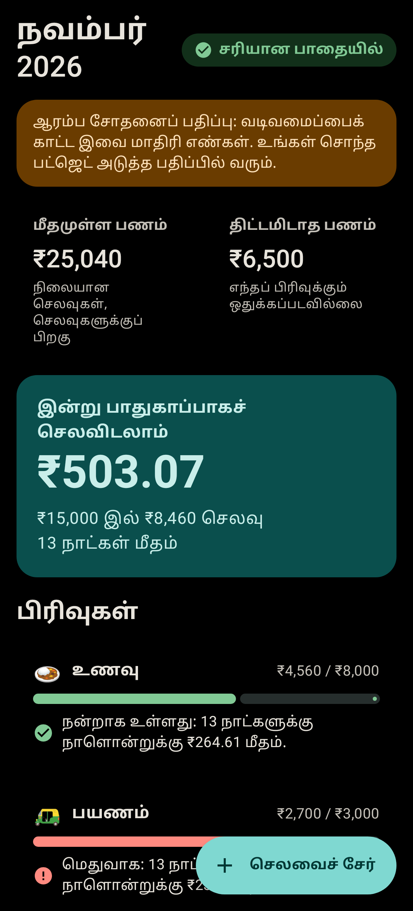
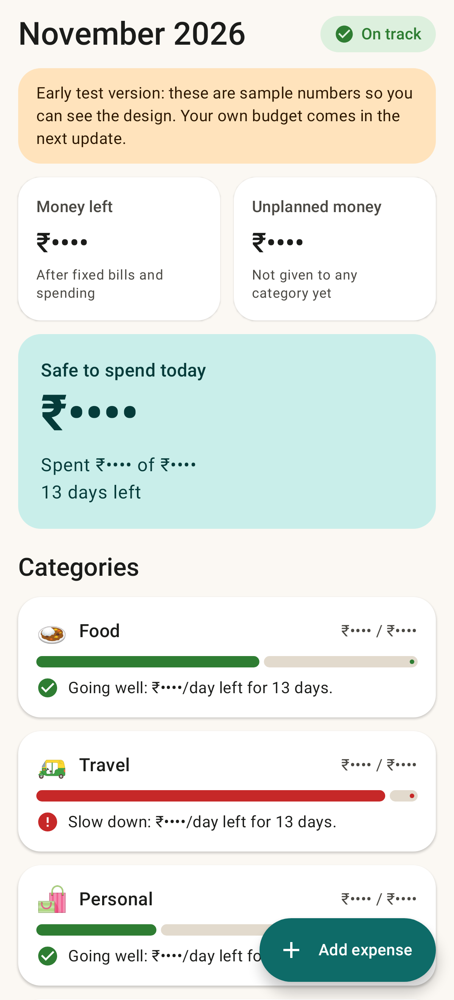
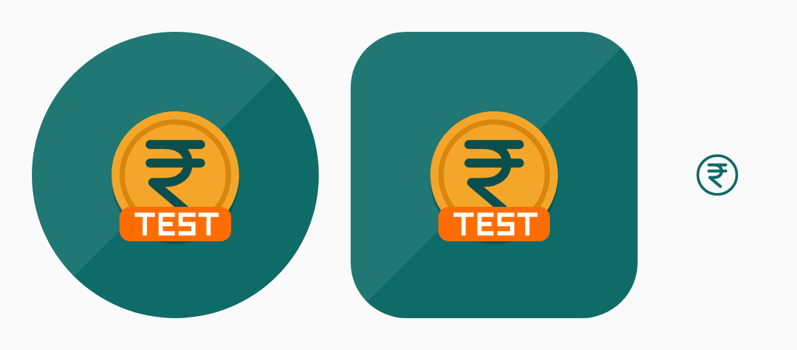

# MySelavu screenshots

Generated automatically by the cloud build (build #2). Light and dark mode, English and Tamil.

### 01_home_en_light

### 02_home_en_dark

### 03_home_ta_light

### 04_home_ta_dark

### 05_home_en_hidden_amounts

### 06_home_en_large_font

### 07_launcher_icons

